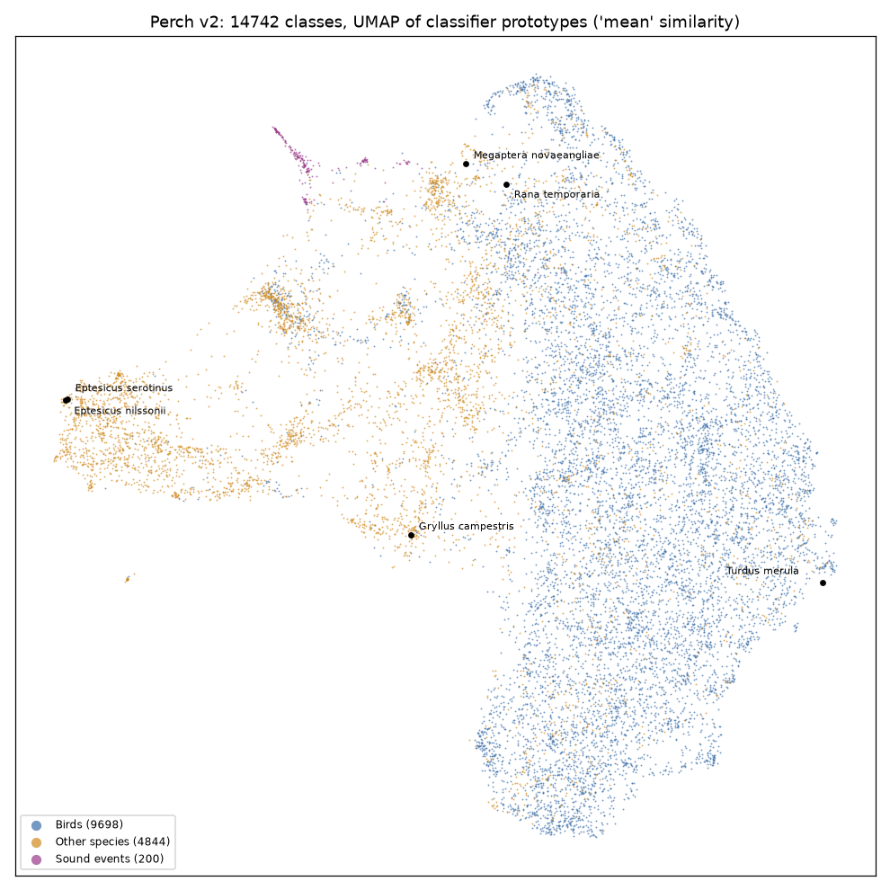

# Perch 2.0 on the device: evaluation

Status: research, 2026-11-11. Nothing here is wired into the app. Companion to
[birdnet-on-device.md](birdnet-on-device.md), which answers the same questions for
BirdNET V2.4. Prototype: [perch-bench/](perch-bench/).

## Recommendation

**Add Perch 2.0 as a second model alongside BirdNET, free like BirdNET.** Decided
2026-11-11: the first step is to let people run each model as it is, with all its
classes, on birds and other animal calls as well as bats. Evaluating and mixing the
models, finding any animal, comparing recordings by similarity and training bat
classifiers come after that. Upstreaming the tract fix waits until later.

The measured reasons to add Perch are its non-bird classes and its licence. For bat
calls its embeddings were no better than BirdNET's in this test.

### What the full model gives, and what the embedding part lacks

| Part | Size | Gives |
|---|---|---|
| Embedding part | 45 MB | A 1,536-value embedding per 5 s window (and a 16 x 4 grid of them). Good for similarity search, clustering, and training classifiers of your own. No species names. |
| Classifier | 364 MB float32, 182 MB float16, 91 MB int8 | A score for each of 14,795 classes per window: about 10,000 birds, frogs, insects, some mammals, 2 bats and 198 sound events (vehicle, water, music and so on). This is what names the animal. |
| Full model file | 409 MB | Both of the above, plus the spectrogram the model computed (the app doesn't need it). |

So with only the embedding part, Oversample can say "these calls sound alike" but not
"this is a Common Swift". Running Perch as it is needs the classifier.

The embedding part plus the classifier gives exactly the full model's results
(logits within 0.00013 of Google's TensorFlow model). Splitting them means:

- **A smaller download.** The classifier can be stored in float16 (182 MB) or int8
  (91 MB). On the 22 test windows both gave the same top species and the same top 5
  as float32; the largest logit difference was 0.0005 for float16 and 0.028 for int8
  ([head_precision.py](perch-bench/head_precision.py)). The full model is then 227 MB
  (float16) or 136 MB (int8), against 409 MB.
- **Less memory and faster.** Built and measured: the embedding part in tract plus the
  int8 classifier in plain Rust ([perch/](../birdnet-worker/src/perch/classifier.rs)) uses 231 MB of
  WASM memory, against 1,231 MB for the full file in tract, and runs at 10 to 11 times
  real time in the browser build, against 7 times. It gives the same top class as the
  full model on 383 of 384 windows (birds, frogs, grasshoppers and crickets, land
  mammals, sound effects, rain, traffic, wind, voices; the other was a tie within
  0.002), and the same top 5 on 382; see [Speed](#speed) and
  [Int8 classifier on other animals](#int8-classifier-on-other-animals).
- **Embeddings without the classifier.** Similarity features can download only the
  45 MB part.

Speed with all classes, as two files: 10 to 11 times real time in the WASM build
(3 minutes of audio in 16 to 17 s), against 23 times for the embedding part alone. The classifier
takes half the time: it compares 59,180 prototypes with 64 positions per window.

- **Licence:** Apache 2.0 for the weights, stated by Google on the Kaggle model page.
  This is much more permissive than BirdNET's CC BY-NC-SA 4.0. It allows a paid tier,
  changed files (quantised, cut, sliced) and bundling with the app. Apache 2.0 is
  compatible with GPL-3.0.
- **It runs in tract, with one fix.** tract 0.23 needs a small rewrite of the ONNX file
  (see [Running it in tract](#3-running-it-in-tract)). After that, tract's output
  matches Google's own TensorFlow SavedModel: the same top species on 22 of 22 windows,
  logits within 0.00013, embeddings with cosine similarity 0.9999999.
- **Size is the problem with the full model.** The ONNX file is 409 MB. 364 MB of that
  is the classifier for 14,795 classes; the embedding part is 45 MB. In the app's
  WASM target, the full model needs 1.2 GB of WASM memory and runs at 7 times real
  time. Split into the embedding part (tract) and an int8 classifier (plain Rust), it
  is 136 MB, needs 231 MB of WASM memory and runs at 10 to 11 times real time. The embedding
  part alone needs 140 MB and runs at 23 to 24 times real time.
- **Slower than BirdNET.** In the same process, under the same load, the Perch
  embedding model analysed 3 minutes of audio in 7.5 to 7.9 s; BirdNET V2.4 took 4.1 to
  4.8 s. Without species names Perch is about 1.8 times slower per second of audio. With
  all its species names (two files, 10 to 11 times real time, against BirdNET's 38 to
  44 times with names) it is about 4 times slower.
- **Bats: no better than BirdNET.** Google removed bats from Perch's training data.
  Checked against the 87 bat genera in bat-demo-sounds, only 2 of Perch's 14,795
  classes are bats (Eptesicus serotinus and E. nilssonii). On 184
  time-expanded bat recordings of 92 species, Perch and BirdNET embeddings found a
  recording of the same species as the nearest neighbour equally often (0.53 to 0.57).
  Both beat a plain spectrum baseline (0.33). See [Bats](#4-bats).
- **Species map: yes.** Perch's classifier stores 4 prototype vectors per class. Their
  weighted mean gives one vector per class, and those vectors group by genus as well
  as BirdNET's classifier weights do (0.59 against 0.60, on the 6,262 species both
  models know). A UMAP map of all 14,742 live classes is a 916 kB JSON file. See
  [Species map](#5-species-map).

Why not replace BirdNET:

- With species names, BirdNET is about 4 times faster, and its whole model is 52 MB,
  against 136 MB for Perch as two files (409 MB as one).
- BattyBirdNET's bat heads only work on BirdNET embeddings.
- Perch's scores come from a softmax-trained head. They are uncalibrated, and species
  in the same window compete with each other. Google recommends tuning a threshold per
  species with your own data.
- Perch has no location model. BirdNET's location model can limit the species list to
  the place and week of the recording. (A community version of Perch, tphakala's
  regional slices, uses BirdNET's location model offline to pick each region's
  species.)

Why add Perch:

- **Licence.** The app can host, cut and quantise the file without ShareAlike or
  NonCommercial terms. (Perch stays free in Oversample anyway, by decision; the
  licence would also allow a paid tier.)
- **Taxa.** Perch knows frogs, crickets, grasshoppers, some mammals (including
  whales) and 198 general sound events (vehicles, water, music). BirdNET V2.4 is
  mostly birds.
- **Embeddings, from published results only.** Google trained them to be linearly
  separable, for agile modelling (a few labelled examples, then a linear classifier)
  and similarity search. Perch 2.0 is state of the art on the BirdSet and BEANS
  benchmarks. On BEANS's bat dataset (Egyptian fruit bat calls), a probe on Perch 2.0
  embeddings scored 0.76 to 0.82 accuracy, against 0.72 for Perch 1.0; BirdNET isn't
  in that table. Whether this helps similar-call search for echolocation calls in the
  Call detection panel was not shown here: on bat calls, Perch and BirdNET embeddings
  tied.
- **A bat classifier of Oversample's own** trained on Perch embeddings could go in any
  tier. One trained on BirdNET embeddings, like BattyBirdNET, inherits CC BY-NC-SA.

How to ship it:

The two converted files are hosted at huggingface.co/pengowray/perch-v2-tract
(revision `f378e7f`, Apache 2.0, with a model card listing the changes), and are in
the app's model catalog (`PERCH_FILES` in `oversample-ipc/src/classifier/catalog.rs`)
with the label list from cgeorgiaw/Perch. The app's model store keeps them like
BirdNET's: OPFS in the browser, the app data folder's `models/` in Tauri.

Built (2026-11-12): Perch 2.0 is a method in the Call detection tab, beside BirdNET and
BattyBirdNET, run in the same model worker (`birdnet-worker/src/perch/`). Its minimum
confidence defaults to 0.30, its 198 sound events count as "Noise and other sounds",
and "Delete model" deletes only its own files. Checked in Chromium (download, analyse,
switching to BirdNET and back) and in the Tauri desktop app on Linux, where it read the
stored files and found the Pauraque at 0.862, as natively. On a 5-minute traffic
recording, one window named a bird (Pink-footed Goose) at 0.32, so 0.30 is not a clean
line. Perch's labels have no common names, so results show scientific names.

1. The 45 MB embedding model (40 MB gzipped), cached the same way as BirdNET's model.
2. The classifier for all 14,795 classes as a separate int8 file (91 MB, 73 MB
   gzipped), run in plain Rust on the embedding model's spatial output
   ([export_head.py](perch-bench/export_head.py) writes it,
   [birdnet-worker/src/perch](../birdnet-worker/src/perch/classifier.rs) runs it:
   integer dot products of the 64 spatial positions against the prototypes, a max over
   positions, and a weighted sum; the inner loop has one file per CPU in
   [perch/kernel/](../birdnet-worker/src/perch/kernel/mod.rs), each compiled only for
   its own target. The bench uses the same code).
   Download it the first time someone runs Perch with species names.
   Hide species results below a softmax probability of about 0.3 (the app's default):
   over 29 minutes of rain, thunder, traffic, wind and voices, 5 of 348 windows still
   put an animal on top at 0.3 or more, the highest at 0.53 (see
   [Sound events](#sound-events)).
3. Later, if wanted: smaller classifier files for a subset of classes, for example a
   region of about 900 classes (about 22 MB in float32) or the 5,044 non-bird classes
   (about 124 MB in float32). tphakala's regional slices pick species with BirdNET's
   bird range model, so a non-bird subset would need its own species list.
4. The species map JSON, built offline by [species_map.py](perch-bench/species_map.py).

Tested in headless Chrome 156 and Firefox 159 in a Web Worker: 12 times real time,
the same answers as native, and the page kept drawing (see [Browsers](#browsers)). Not
tested: the Tauri webview, headed browsers, phones, onnxruntime-web, tphakala's INT8 file, the classifier on ARM, Perch against BirdNET on
bird identification accuracy, and a classifier trained on Perch embeddings for bats. See
[Not tested](#not-tested).

## 1. Model files

Perch 2.0 is Google DeepMind's bioacoustics model, released in August 2025 (paper:
van Merriënboer et al., "Perch 2.0: The Bittern Lesson for Bioacoustics", arXiv
2508.04665). No newer version was found. The Kaggle variation `perch_v2` is at version
2 (version 2 only fixes a directory problem).

| Model | Format | Size | Source | Licence |
|---|---|---|---|---|
| Perch 2.0, `perch_v2` (needs a GPU) | TF SavedModel | 407 MB | Kaggle `google/bird-vocalization-classifier`, also mirrored at `cgeorgiaw/Perch` on Hugging Face | Apache 2.0 |
| Perch 2.0, `perch_v2_cpu` | TF SavedModel | 392 MB | Kaggle, same page | Apache 2.0 |
| Perch 2.0 | TFLite FP32 | 407 MB | `justinchuby/Perch-onnx` (conversion) | Apache 2.0 |
| Perch 2.0 | ONNX FP32, with a `DFT` operator | 409 MB | `justinchuby/Perch-onnx`; same file in `tphakala/Perch-v2-Models` | Apache 2.0 |
| Perch 2.0 | ONNX FP32, DFT replaced by MatMul | 413 MB | `justinchuby/Perch-onnx` | Apache 2.0 |
| Perch 2.0 | ONNX, INT8 MatMuls | 131 MB | `tphakala/Perch-v2-Models` | Apache 2.0 |
| Perch 2.0, regional slices (43 regions, 272 to 3,535 classes each) | ONNX FP32 / INT8 | 56 to 136 MB / 42 to 62 MB | `tphakala/Perch-v2-Models` | Apache 2.0 |
| Perch 2.0, embedding part only (cut here) | ONNX FP32 | 45 MB | made by [split.py](perch-bench/split.py) | Apache 2.0 |

- **Input:** 160,000 samples, which is 5 s of mono audio at 32 kHz. The model computes
  its own log-mel spectrogram (500 frames by 128 mel bands, 60 Hz to 16 kHz), so the
  app only resamples and cuts windows. BirdNET takes 3 s at 48 kHz.
- **Outputs:** a 1,536-value embedding (the mean over space), a spatial embedding of
  16 x 4 x 1,536 values, the spectrogram, and 14,795 logits.
- **Network:** an EfficientNet-B3 with about 12 million parameters, then a classifier
  with 91 million parameters. In the ONNX file the classifier is one
  1,536 x 59,180 matrix: 4 unit-length prototypes per class (see section 5).
- **Classes:** 14,795. The paper says 14,597 are species and 198 are FSD50K sound
  events. The model card says about 10,000 are birds; 9,706 classes have an eBird
  code. The rest are frogs and other amphibians, insects, mammals, sound events and
  some birds without an eBird code. Training audio came from xeno-canto,
  iNaturalist, the Animal Sound Archive (Tierstimmenarchiv) and FSD50K.
- **Bats:** the paper says bats were removed from the training data because their
  vocalizations "cannot be represented using the spectrogram parameters we selected".
  Two bat species remain as classes: Eptesicus serotinus and Eptesicus nilssonii.
  This was checked by matching Perch's labels against the 87 bat genera in
  bat-demo-sounds, so a bat genus missing from that set could add a few more.
- **Dead classes:** 53 classes have all four prototype weights at zero, so their
  logit is a constant. Examples: Agriotes lineatus, Bos bison, Ceyx gentianus.

## 2. Licence

- **Weights:** the Kaggle model card says "Copyright 2025 Google, LLC. Licensed under
  the Apache License, Version 2.0", and the `perch_v2` variation lists its licence as
  Apache 2.0. The labels files ship with the model.
- **Code:** `google-research/perch` and `perch-hoplite` are Apache 2.0.
- **Commercial use:** Apache 2.0 allows it. When asked in a GitHub issue about using the
  weights commercially in a mobile app, the Perch team replied that they can't give
  legal advice and pointed to the Apache 2.0 text.
- **What the app must do:** keep the licence text and copyright notice with the model
  file, and say if the file was changed (for example "embedding part cut out, Conv
  layers folded for tract"). There is no ShareAlike or NonCommercial term.
- **Compared with BirdNET:** BirdNET V2.4's weights are CC BY-NC-SA 4.0 at best. Perch
  could go in a paid tier and could be bundled with the app; BirdNET can't.
- **Credit:** cite van Merriënboer et al. (2025), arXiv 2508.04665, and link the Kaggle
  page. Credit justinchuby for the ONNX conversion if that file is used.

This is a reading of the licences, not legal advice.

## 3. Running it in tract

### The tract fix

tract 0.23 can't load justinchuby's ONNX file with a batch size of 1:

```
in output_facts invocation for node_Conv_8: Conv
Bias should be scalar or a vector with one value per output channel.
Output channels is 40, bias is 40,1,F32
```

With batch 2 the same file loads and runs. Judging by the error, with a batch of 1
tract's optimiser appears to drop the batch axis from each convolution and then fold
the batch-norm scale and shift that follow it into the convolution's bias with the
wrong shape. This looks like a tract bug; it was not reported upstream.

[fix_for_tract.py](perch-bench/fix_for_tract.py) does that fold in the ONNX file
before tract sees it: each Conv followed by Transpose, Mul and Add gets new weights and
bias, and the Mul and Add are removed (78 convolutions, 156 nodes). The result is the
same function. tract then loads it with batch 1. tract's `DFT` operator works, so the
no-DFT file isn't needed.

### Speed

Machine: Ryzen 5 3600 (6 cores, 2019), Linux, node 24 (V8, the engine in Chrome),
one thread. Other sessions were building code on the same machine, so the
wasm-bindgen rows ran in one node process that took turns between Perch and BirdNET,
3 rounds each, on the same 3 minutes of audio (Common Pauraque, repeated). BirdNET's
times in that process (68 to 73 ms per window) match the earlier quiet-machine
measurement (64 to 74 ms), so the comparison is fair.

| Runtime | Model | ms per window | 3 min of audio | Real time | Memory |
|---|---|---|---|---|---|
| tract, `wasm32-unknown-unknown` + wasm-bindgen + SIMD, opt-level 3 | Perch, full (14,795 classes) | 686 to 703 per 5 s | 24.8 to 25.8 s | 7x | 1,231 MB WASM memory (1.8 GB node RSS) |
| same | Perch, embedding part + int8 classifier in plain Rust (14,795 classes) | 413 to 428 per 5 s (classifier 208 to 214) | 15.8 to 17.3 s | 10 to 11x | 231 MB WASM memory |
| same | Perch, embedding only | 206 to 219 per 5 s | 7.5 to 7.9 s | 23 to 24x | 140 MB WASM memory |
| same | Perch, embedding only, no DFT | 228 per 5 s | 8.3 s | 22x | 152 MB WASM memory |
| same | Perch, central Europe slice (873 classes) | 260 to 262 per 5 s | 9.4 s | 19x | 217 MB WASM memory |
| same | BirdNET V2.4 (for comparison) | 68 to 73 per 3 s | 4.1 to 4.8 s | 38 to 44x | 160 MB WASM memory |
| tract, native | Perch, full | 281 per 5 s | 10.3 s | 18x | 1,223 MB RSS |
| tract, native | Perch, embedding part + int8 classifier in plain Rust (AVX2) | 272 per 5 s (classifier 157) | about 9.8 s | 18x | 264 MB RSS |
| tract, native | Perch, embedding only | 118 per 5 s | 4.3 s | 42x | 186 MB RSS |
| onnxruntime 1.31, Python, under load | Perch, full | 194 per 5 s | about 7 s | 26x | |
| onnxruntime 1.31, Python, under load | Perch, embedding only | 122 per 5 s | about 4.4 s | 41x | |
| TensorFlow 2.20, Google's `perch_v2_cpu` SavedModel | Perch, full | 1,348 per 5 s | | 4x | |
| LiteRT (TFLite), justinchuby's file | Perch, full | 2,071 per 5 s | | 2x | 2.1 GB RSS |

- The memory column isn't comparable across runtimes; see the BirdNET page for why.
  The WASM memory figures come from the wasm32-wasip1 build of the same code, which
  reports its linear memory directly; the two-file row's figure comes from the
  wasm-bindgen build itself.
- The tract WASM module is 14.9 MB (3.7 MB gzipped), the same as BirdNET's, because it
  is the same tract code.
- Loading (parse and optimise) in the process shared with BirdNET: 1.5 to 1.8 s for the
  Perch embedding model and 2.2 s for the full model, against 0.5 to 0.8 s for BirdNET.
- The classifier is a large part of the time: 14,795 classes x 4 prototypes x 64
  positions x 1,536 values is 5.8 billion multiply-adds per window. A region of about
  900 classes adds 20 to 25 percent to the embedding time.
- The plain-Rust classifier ([perch/](../birdnet-worker/src/perch/classifier.rs)) keeps the prototypes
  as int8 and each spatial position as int16 with its own scale, and sums the products
  as integers: WASM SIMD's `i32x4.dot_i16x8_s` does 8 multiply-adds per instruction,
  where float32 needs two instructions for 4. In WASM it takes 208 to 214 ms per window,
  against about 480 ms for the same classifier inside tract's full model. Natively it
  has SSE2 and AVX2 versions (chosen at run time); with AVX2 it takes 157 ms, and with
  SSE2 201 ms. Other CPUs (ARM) get a plain integer loop, which the compiler didn't
  vectorise on x86 (3.8 s). A first float32 version of the classifier, written so the
  compiler vectorises it, took 507 ms natively with the same answers, so a usable
  portable path exists; ARM needs one of the two before this is used outside the
  browser.
- The native two-file row was built without LTO (16 codegen units), unlike the other
  native rows; its embedding time (114 ms) matches theirs (118 ms).
- The two-file rows were measured in separate node runs (alternating with the full
  model, which again took 686 to 690 ms), not in the BirdNET process. Their embedding
  times (205 to 216 ms) match the table's other rows, so the machine load was similar.
- Loading the two files, in those separate runs: 1.2 to 1.3 s for the embedding model
  and 0.1 s for the classifier, against 2.2 s for the full model.
- The plain wasm32-wasip1 build ran while the machine was busier, so its times (310 to
  410 ms for the embedding model, 1 s for the full model) are left out of the table.

### Browsers

Perch as two files (embedding model in tract, int8 classifier in Rust, 136 MB) on the
same test page as BirdNET ([web/](perch-bench/web/)): both files cached in OPFS, run in a
module Web Worker or on the main thread, 36 windows (3 minutes of audio). Run on
2026-11-12 once the machine was quiet (load average 2.4 to 3.8 on 12 threads, against 20
to 36 while other builds ran).

| Browser | ms per window (median, worker) | Embedding model / classifier | 3 min of audio | Load, cold | Load, warm |
|---|---|---|---|---|---|
| Chrome 156 (Chrome for Testing, headless) | 391 to 392 | 186 / 204 | 14.6 s (12x) | 1.77 s | 1.43 s |
| Firefox 159 (headless) | 409 to 415 | 199 to 203 / 207 to 210 | 15.4 s (12x) | 1.68 s | 1.31 s |
| BirdNET V2.4 in the same page, for comparison (Chrome) | 66 to 69 per 3 s | | 4.2 to 4.4 s (41 to 43x) | 0.70 s | 0.57 s |

- **Same answers:** in both browsers, in the worker and on the main thread, the top class
  matched the native build on all 36 windows.
- **Load:** most of it is tract optimising the embedding model (0.9 to 1.4 s). Reading
  both files from OPFS took 28 to 77 ms in Chrome and 92 to 174 ms in Firefox; building
  the classifier took 44 to 55 ms. Over a real connection, the 136 MB download takes
  about 11 s at 100 Mbit/s and about 55 s at 20 Mbit/s.
- **Page responsiveness:** in the worker, no frame took over 17 ms in Chrome, and one
  frame took 50 ms in Firefox. On the main thread nearly every frame was over 50 ms
  (36 of 71 in Chrome, longest 850 ms), because one window takes about 400 ms and can't
  be split. Perch must run in a worker.
- **Memory:** summed PSS of the browser's processes, peak over the three page loads,
  minus the same page with no model:

  | Browser | Peak with Perch | Peak without | Added by Perch |
  |---|---|---|---|
  | Chrome | 837 MB | 425 MB | about 410 MB |
  | Firefox | 1,153 MB | 670 MB | about 480 MB |

  The WASM memory was 231 MB in both. BirdNET added about 285 MB in Chrome and 305 MB in
  Firefox.

### Accuracy

Test audio: 6 bird recordings from `batchi-extras/no-bat-sounds` (Common Swift, Common
Pauraque, Common Scoter, Alpine Swift, Cave Swiftlet, Asian Palm Swift), resampled to
32 kHz and cut into 22 windows of 5 s. Reference: Google's `perch_v2_cpu` SavedModel
in TensorFlow 2.20 ([ref_tf.py](perch-bench/ref_tf.py)).

| Run | Same top-1 | Largest logit difference | Lowest embedding cosine |
|---|---|---|---|
| tract native, full | 22 of 22 | 0.00013 | 0.9999999 |
| tract wasm-bindgen, full | 22 of 22 | 0.00011 | 0.9999999 |
| tract wasm32-wasip1, full | 22 of 22 | 0.00011 | 0.9999999 |
| tract native and wasm, embedding only (with or without DFT) | | | 0.9999999 |
| tract native and wasm, central Europe slice (its 873 classes) | 22 of 22 | 0.00094 | 0.9999999 |
| embedding model + classifier in numpy ([ref.py](perch-bench/ref.py)) | 22 of 22 | 0.00013 | 0.9999999 |
| tract embedding model + int8 classifier in Rust, native and wasm-bindgen (top 5 also the same, in the same order, on 22 of 22) | 22 of 22 | 0.028 | 0.9999999 |
| onnxruntime, full | 22 of 22 | 0.00013 | 0.9999999 |
| LiteRT, justinchuby's TFLite file | 22 of 22 | 0.00133 | 0.9999999 |

Top-1 results: Common Swift (one window as Pallid Swift), Common Pauraque, Common
Scoter, Alpine Swift and Asian Palm Swift were found, with softmax probabilities of
0.3 to 0.9. The 3 Cave Swiftlet windows came out as other species (Green Kingfisher,
Great Spotted Woodpecker, California Quail) with probabilities under 0.1.

### Int8 classifier on other animals

Test audio: all 69 recordings in `batchi-extras/no-bat-sounds` (xeno-canto: 15 birds,
6 frogs, 29 grasshoppers and crickets, 19 land mammals), up to 6 windows of 5 s each,
256 windows in all. Reference: the full model in onnxruntime, which matched Google's
TensorFlow model to 0.00013 above. The TensorFlow environment was gone by then. Script:
[recheck.py](perch-bench/recheck.py).

| Group | Windows | Same top 1 | Same top 5 (as a set) | Same top 5, same order |
|---|---|---|---|---|
| Birds | 54 | 54 | 53 | 49 |
| Frogs | 16 | 16 | 16 | 16 |
| Grasshoppers and crickets | 121 | 121 | 121 | 120 |
| Land mammals | 65 | 65 | 65 | 62 |
| All | 256 | 256 | 255 | 247 |

Native and wasm-bindgen gave identical results; the largest logit difference was
0.031. In each of the 9 windows whose top 5 differs, the two swapped classes were
within 0.0002 to 0.0103 of each other in the reference, which is less than the int8
rounding error. In the one window where the set differs, the 5th and 6th classes swap
(0.008 apart).

The same run also shows how well Perch names these animals, from the reference's
logits (the species' best rank over a recording's windows; the 6 recordings with no
species name are left out):

| Group | Recordings | Species is the top class | Species in the top 5 |
|---|---|---|---|
| Birds | 15 | 11 | 13 |
| Frogs | 6 | 2 | 3 |
| Grasshoppers and crickets | 29 | 18 | 21 |
| Land mammals | 13 | 0 | 1 |

- The species of all 63 named recordings are Perch classes, including the shrews,
  squirrels, badger, otter and deer.
- These are likely optimistic: Perch was trained on xeno-canto and iNaturalist, so
  these recordings, or others by the same recordists, may be in its training data.
- The recordings were made at 192 to 500 kHz, and Perch only hears up to 16 kHz. Shrews
  call mostly above that, which may be why the land mammals do badly.
- A sound-event class (198 of them, such as Wind, Engine, Cricket) was the top class in
  3 of 256 windows, and in the top 5 in 11.
- Set against the sound recordings below: when the right species was on top, its
  softmax probability was at least 0.03 (median 0.72 for birds, 0.47 for grasshoppers
  and crickets, 0.27 for the 2 frog windows). A cutoff of 0.3 keeps 61 of those 81 windows.

### Sound events

Test audio, in `batchi-extras/sound-event-sounds` (with an `index.json` of sources and
licences; [fetch_commons.py](perch-bench/fetch_commons.py) downloads it): 12 Wikimedia
Commons recordings of rain (4), thunder, road traffic (2), wind, voices (2), a river and
one music track, converted to 32 kHz and cut into 69 windows. Also 19 local Freesound
sound effects (37 windows): footsteps, splashes, bells, glass, a coffee machine, a
pressure cooker.

The int8 classifier against the full model in onnxruntime:

| Recordings | Windows | Same top 1 | Same top 5 (as a set) | Same top 5, same order |
|---|---|---|---|---|
| Commons recordings | 69 | 68 | 68 | 64 |
| Freesound effects | 37 | 37 | 37 | 34 |

The one different top 1 is a tie in the reference: Musical_instrument 8.8946 and
Music 8.8924. The largest logit difference was 0.027.

What Perch called them (its top classes over each recording):

- **Named well:** thunder (Thunder, Thunderstorm, Rain), street traffic (Vehicle, Car
  horn, Motor vehicle), a group discussion (Human voice), the river (Water, Ocean),
  footsteps (Walk and footsteps), a splash (Splash and splatter, Liquid), a ship's bell
  (Bell), finger clicks (Hands, Finger snapping), a light switch (Glass, Chink and
  clink). "Fall Rain" on Commons is a music track by Antti Luode, and Perch called it
  Music and Keyboard; it was relabelled as music.
- **Animals that weren't there:** steady rain is the weak spot. In 15 of 23 rain windows
  the top class was a bird or insect (mostly Tawny Owl and Barred Owl, once a
  cicada); the other 8 were Water, and Rain itself was never the top class. Howling wind
  came out as Coyote (Canis latrans) in 3 of 6 windows, with Wind second. Traffic and
  thunder put a bird or frog on top in 7 of 18 windows.
- **Their scores were low:** in these first 30 s of each recording, every one of the 25
  false animal windows had a softmax probability of 0.27 or less (median 0.02 for rain,
  0.07 for traffic, 0.20 for wind). On the xeno-canto recordings above, 61 of 81 windows
  with the right species on top scored 0.3 or more.
- **The whole recordings:** run in full (29 minutes, 348 windows), 184 windows had an
  animal on top, and 5 of them scored 0.3 or more: 1 of rain (0.39), 2 of thunder (up
  to 0.33), 1 of traffic (0.32, a Pink-footed Goose) and 1 of wind (0.53). At 0.4, 1
  window is left; at 0.5, also 1. So 0.3 hides almost all false animals and keeps most
  real detections, on this small set; it is the app's default.

## 4. Bats

Method ([bats.py](perch-bench/bats.py)):

- **Recordings:** every bat recording in `batchi-extras/bat-demo-sounds` that is WAV,
  recorded at 192 kHz or more, of a species with at least 2 such files: 184 recordings,
  92 species, 51 genera. Every species has exactly 2 recordings. None of the xeno-canto
  notes mention time expansion. For 59 species both recordings are by the same
  recordist, and for 33 species by two different recordists.
- **Time expansion:** each recording is resampled to a higher rate and then read as the
  model's own rate. Perch was run at 8x (256 kHz read as 32 kHz: 0.625 s of real time
  per window, calls up to 128 kHz in range) and 10x (320 kHz: 0.5 s, up to 160 kHz).
  BirdNET was run at 5.33x (256 kHz read as 48 kHz, as BattyBirdNET does: 0.56 s, up to
  80 kHz in BirdNET's 15 kHz range) and 10x (480 kHz: 0.3 s, up to 150 kHz).
- **Windows:** most windows of a bat recording hold no call, so each recording's
  embedding is the mean of its 3 windows with the most energy between 15 and 120 kHz.
- **Scores:** cosine distance after subtracting the mean embedding. For each recording,
  is the nearest other recording the same species (chance: 0.005)? The same genus? And
  the silhouette score: how tight each species is compared with its nearest other
  species, from -1 to 1.
- **Baseline:** the mean log power spectrum of the same windows, in 1 kHz bands from 10
  to 128 kHz.

| Embedding | Nearest is same species | Same genus | Species, same recordist | Species, two recordists | Silhouette, species | Silhouette, genus |
|---|---|---|---|---|---|---|
| Perch, 8x | 0.533 | 0.630 | 0.729 | 0.182 | +0.207 | +0.057 |
| Perch, 10x | 0.565 | 0.658 | 0.788 | 0.167 | +0.217 | +0.062 |
| BirdNET, 5.33x (BattyBirdNET's setting) | 0.549 | 0.652 | 0.771 | 0.152 | +0.157 | +0.000 |
| BirdNET, 10x | 0.543 | 0.647 | 0.771 | 0.136 | +0.189 | +0.038 |
| Mean log spectrum (baseline) | 0.332 | 0.413 | 0.508 | 0.015 | -0.121 | -0.393 |

Paired counts, for the species column: Perch at 10x got 15 recordings right that
BirdNET at 5.33x got wrong, and BirdNET got 12 right that Perch got wrong. A McNemar
test on 15 against 12 gives p of about 0.7, so the difference could be chance. Against
the spectrum baseline, Perch at 10x got 51 right that the baseline missed and missed 8
that the baseline got.

What this shows:

- **No clear winner.** Perch at 10x finds the same species slightly more often than
  BirdNET, and its species clusters are a little tighter (silhouette 0.22 against 0.16
  to 0.19). The differences are a few recordings out of 184.
- **Recordist matters more than the model.** When both recordings of a species are by
  the same person, both models find the match 73 to 79 percent of the time. When they
  are by different people, only 14 to 18 percent. Much of what both models match is
  the recorder, microphone and site, not the bat. A similarity search across the
  user's own recordings will work better than one across other people's.
- **Both models beat the plain spectrum,** so both embeddings carry more than the call's
  frequency band.
- **8x or 10x for Perch:** 10x scored higher overall (0.565 against 0.533) but lower on
  the species with two recordists (0.167 against 0.182). The test can't tell them
  apart.

## 5. Species map

Yes, the map can be built from Perch's classifier, the same way as the BirdNET map,
with one change: Perch has no single weight vector per class.

- **What the classifier stores:** for each class, 4 unit-length prototype vectors in
  the 1,536-value spatial embedding space, a non-negative weight for each prototype,
  and a bias. A window's logit for a class is the bias plus the weighted sum, over the
  4 prototypes, of the prototype's best cosine match anywhere in the window's 16 x 4
  spatial grid. [split.py](perch-bench/split.py) extracts the prototypes; ref.py
  rebuilds the logits from them in numpy and matches the model to 0.00013.
- **One point per class:** a class's 4 prototypes point in nearly unrelated directions
  (median cosine 0.06 between prototypes of the same class). Three ways to get one
  vector per class were compared. The score is how often a species' nearest other
  class is in the same genus, counting only species whose genus has at least one
  other species in the model:

  | Class vector | All Perch species (12,829 counted; random 0.001) | Species BirdNET also has (5,477 counted; random 0.002) |
  |---|---|---|
  | Weighted mean of the 4 prototypes | 0.439 | 0.586 |
  | Highest-weight prototype only | 0.248 | 0.337 |
  | Closest pair of prototypes between two classes | 0.312 | 0.415 |
  | BirdNET V2.4 classifier weights, for comparison | 0.597 (all 5,713 counted) | 0.601 |

  On the species both models know, the weighted mean groups relatives as well as
  BirdNET's weights do. Over all of Perch's species the score is lower (0.44); the
  extra species are mostly non-birds, and this check didn't look into why.
- **The map:** UMAP (cosine) on the weighted means, without the 53 dead classes, gives
  a JSON file of 14,742 points, 916 kB (index, name, x, y, coordinates rounded to 4
  decimals). Birds, other species and sound events form separate regions; the two bat
  classes sit at the edge of the non-bird species region.

  

  On the 2D map, the nearest class shares the genus for 0.108 of species, against 0.215
  for a BirdNET map made the same way. The 2D map loses much of the grouping that the
  1,536-value vectors have (0.439), probably more so with 14,742 classes than with
  6,522. Neighbours on the map are often not relatives.
- **Placing a detection:** use the window's logits (its top classes). A detection can
  sit at its top class's point, or at a logit-weighted average of its top few. Matching
  embeddings to the map's vectors doesn't find the right class
  ([placement.py](perch-bench/placement.py)):

  | Match | Top class found, all 22 windows | Top class found, 13 windows with top-1 probability 0.3 or more | Median rank of the matched class in the logits |
  |---|---|---|---|
  | Pooled embedding to nearest class vector (weighted mean) | 5 | 5 | 2 to 3 |
  | Pooled embedding to nearest single prototype | 6 | 6 | |
  | Best spatial position to nearest class vector | 0 | 0 | about 14,000 |

  The classifier compares each prototype with each of the 64 spatial positions, not
  with the pooled average, so only the classifier itself gives the right class.
  With a regional classifier file, detections can only land on that region's classes.
  Matching the pooled embedding to the class vectors (a 14,742 x 1,536 table, 45 MB in
  float16) would place every detection, but only near the right class: the matched
  class was typically the 2nd or 3rd in the logits.
- **A bat map** for Perch would have only the 2 Eptesicus classes, so bats would need
  their own map, built from a bat classifier trained on Perch or BirdNET embeddings.

## Not tested

- **Tauri and headed browsers.** Perch ran in node and in headless Chrome and Firefox,
  not in the Tauri webview (WebKitGTK) or a browser window on screen. For BirdNET,
  WebKitGTK was about as fast as Firefox, but it has no OPFS, so the 136 MB would be
  downloaded again each time unless the app caches it another way. The full single-file
  model was not run in a browser.
- **Phones.** No Android device was connected.
- **onnxruntime-web,** WebGPU and more than one thread.
- **INT8 and float16.** The tphakala INT8 file (131 MB) uses MatMulInteger, which was 4
  times slower than float32 in tract for BirdNET, so it wasn't run. The int8
  classifier in Rust was checked on 384 windows of animals and sound events. The
  float16 classifier was checked in numpy only.
- **The 0.3 cutoff** comes from 81 correct windows and 25 false ones. It needs more
  recordings, and a look at the second and third classes, which the app may also show.
- **The Rust classifier on ARM** (Apple silicon, Android when not in the browser): only
  a plain fallback loop exists for it, and the x86 version of that loop was 24 times
  slower than the SIMD one.
- **Bird identification quality.** Perch against BirdNET on the same bird recordings
  was not compared; the 22 test windows only checked that tract matches TensorFlow.
- **A trained bat classifier.** The bat test only used nearest neighbours on raw
  embeddings. A linear classifier on each model's embeddings, trained on more
  recordings per species, is the fairer test of which embedding suits bats.
- **Other time-expansion factors** than 8x and 10x for Perch.
- **The tract bug** was worked around, not reported upstream.

## Sources

- Perch 2.0 on Kaggle, model card and licence:
  kaggle.com/models/google/bird-vocalization-classifier (variations `perch_v2` and
  `perch_v2_cpu`)
- Paper: arxiv.org/abs/2508.04665 ("Perch 2.0: The Bittern Lesson for Bioacoustics")
- Code: github.com/google-research/perch, github.com/google-research/perch-hoplite
- Licence question: github.com/google-research/perch/issues/799
- ONNX and TFLite conversions: huggingface.co/justinchuby/Perch-onnx
- INT8 and regional slices: huggingface.co/tphakala/Perch-v2-Models
- SavedModel mirror and labels: huggingface.co/cgeorgiaw/Perch
- tract: github.com/sonos/tract (`tract-onnx` 0.23.10)
